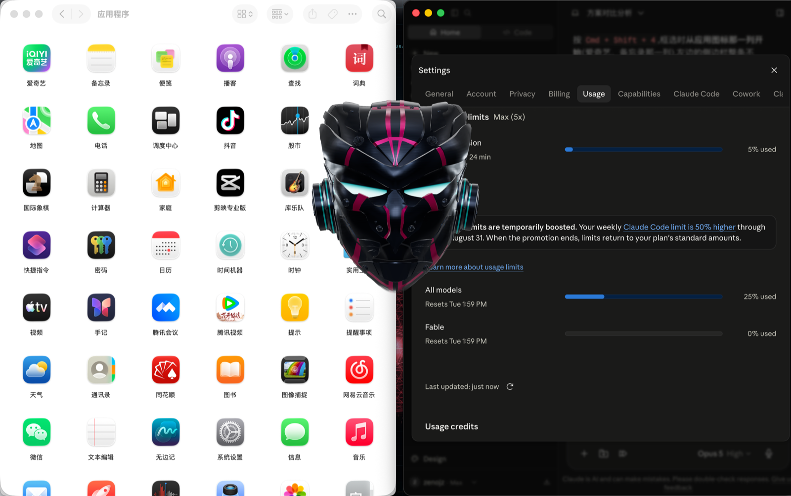

# Ashley · 桌面语音助手（Windows 中文版）



一个悬浮在 Windows 桌面上的 3D 黑金头盔语音助手，灵感来自钢铁侠的 J.A.R.V.I.S.。喊一声「贾维斯」即可唤醒，随后可以实时语音对话、打开应用、搜索网页、查询天气。

> 本项目由 macOS 上游开源项目移植至 Windows，并改造为中文交互。原始项目作者：[@陆叁昧](https://www.douyin.com/user/601786286)（抖音）。

## 功能特性

- **离线唤醒**：说「贾维斯」即可唤醒，唤醒词检测与声纹识别完全本地运行，不联网、不花钱
- **全双工语音对话**：接入豆包（火山引擎）实时语音大模型，支持随时打断它说话
- **3D 黑金头盔**：Three.js 渲染，唤醒时金色粒子装配成型，支持缩小到右下角 / 放大居中 / 全息投影模式
- **本地能力**：打开应用（Chrome、记事本等）、搜索网页、查询天气、查看时间
- **声纹识别**：录入你的声音后，只有你能唤醒它（可选）
- **控制指令**：说「退下」收起头盔，说「完全退出」关闭程序

## 环境要求

- Windows 10 / 11（64 位）
- 麦克风 + 扬声器/耳机
- Node.js 22 或更高版本
- pnpm 9 或更高版本
- C 盘剩余空间 ≥ 2 GB

## 快速开始

### 1. 安装依赖

```powershell
pnpm config set registry https://registry.npmmirror.com
$env:ELECTRON_MIRROR="https://npmmirror.com/mirrors/electron/"
$env:ELECTRON_BUILDER_BINARIES_MIRROR="https://npmmirror.com/mirrors/electron-builder-binaries/"
pnpm install
```

### 2. 配置 API 密钥

复制模板并编辑：

```powershell
copy .env.example .env
notepad .env
```

国内用户推荐使用**豆包（火山引擎）**，在[火山引擎控制台](https://www.volcengine.com/docs/6561/196768)开通实时语音服务后，填写以下三项：

```dotenv
JARVIS_VOICE_PROVIDER=doubao
DOUBAO_APP_ID=你的AppID
DOUBAO_API_KEY=你的APIKey
DOUBAO_RESOURCE_ID=你的ResourceID
```

> 三项缺一不可，尤其是 `DOUBAO_RESOURCE_ID`，否则会报 `requested resource not granted`。

### 3. 启动

```powershell
pnpm dev
```

首次启动会自动编译（约 1~2 分钟）。看到系统托盘出现头盔图标后，对着麦克风说「贾维斯」即可。

> 首次运行请在 Windows 设置 → 隐私和安全性 → 麦克风中，允许桌面应用访问麦克风。

## 常用语音指令

| 说法 | 效果 |
| --- | --- |
| 贾维斯 | 唤醒头盔 |
| 今天天气怎么样 / 现在几点 | 查询天气/时间（天气需配置和风天气） |
| 打开 Chrome / 打开记事本 | 启动应用 |
| 搜索一下今天的新闻 / 打开百度 | 网页搜索与打开 |
| 缩小 / 右下角 | 头盔缩小到屏幕右下角 |
| 放大 / 居中 | 头盔重新居中放大 |
| 全息投影 | 切换半透明全息效果 |
| 退下 / 拜拜 | 收起头盔（监听继续） |
| 完全退出 | 退出整个程序 |

全局快捷键 `Ctrl + Shift + J` 可手动显示/隐藏头盔。

## 打包为 Windows 安装包

```powershell
pnpm package:win
```

产物位于 `release\Ashley-0.1.0-x64.exe`，双击即可安装。

## 目录结构

```
├── src/                # 源代码（Electron 主进程 + 渲染层）
├── assets/             # 3D 模型、音效、唤醒模型、声纹模型
├── scripts/            # 构建脚本与唤醒词训练工具
├── dist/               # 编译产物（pnpm build 后生成）
├── patches/            # 依赖补丁
├── docs/               # 文档与截图
└── .env                # 你的私密配置（自行创建，勿提交）
```

## 数据与隐私

- 唤醒词检测、声纹识别均在本地运行，模型随项目分发
- 语音对话必须联网，数据经由豆包/OpenAI 云端处理
- 声纹数据保存在 `%APPDATA%\Ashley\`，不上传
- 运行日志：`%APPDATA%\Ashley\runtime.log`

## 致谢

- 原始 macOS 项目作者：[抖音 @陆叁昧](https://www.douyin.com/user/601786286)
- 3D 头盔模型：[Sci-Fi Helmet - Ngchipv](https://sketchfab.com/3d-models/sci-fi-helmet-high-poly-ngchipv-2f7218f88b94455cb69411e4069dc3b9)，许可 CC BY 4.0
- 唤醒与声纹引擎：[Sherpa-ONNX](https://github.com/k2-fsa/sherpa-onnx)

## License

源代码基于 [MIT License](LICENSE) 发布。3D 头盔模型遵循 CC BY 4.0 协议。
